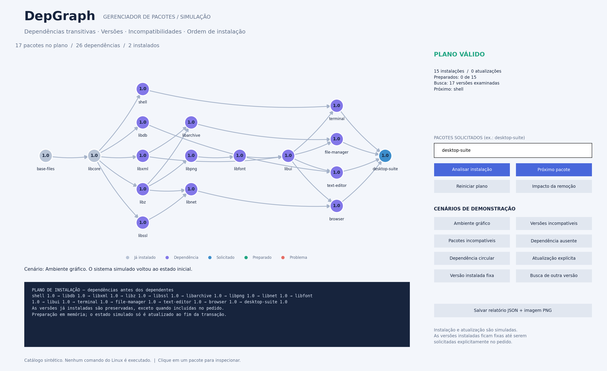
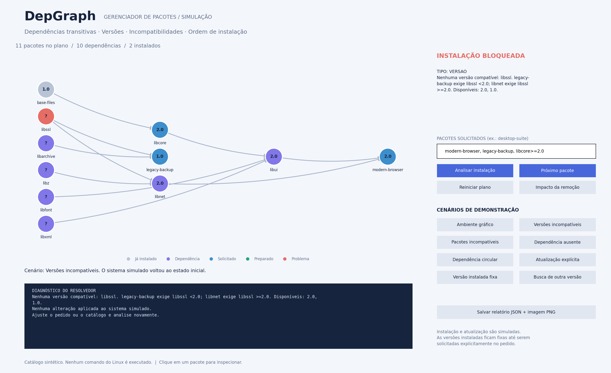

# DepGraph — Gestão de Conflitos em Sistemas de Dependência

Trabalho prático de Grafos — **Tema 9**.

O DepGraph é um simulador de gerenciamento de pacotes inspirado no Linux. A partir de um pedido de instalação, um catálogo e um estado de pacotes já instalados, identifica dependências transitivas, seleciona versões compatíveis, detecta conflitos e calcula uma ordem segura de instalação.

## Integrantes

- Lucas Batista Duarte
- Caio Alves Kfuri
- Arthur Chaves Viana Leão
- Rafael Abras Lessa Freitas
- David Dias Pinto
- Joao Vitor Heleno Marinho

## Estado atual

O simulador de pacotes usa **grafo e algoritmos próprios**, com **Matplotlib** para a interface e contém **27 pacotes com 32 versões** em um catálogo sintético. O exemplo principal instala um ambiente gráfico com **17 pacotes e 26 dependências**, preservando os dois pacotes inicialmente instalados.

A aplicação funciona em uma janela local e simula transações em memória. Os nomes, versões e relações são fictícios; nenhum comando Linux é executado.

O primeiro exemplo genérico de tarefas foi substituído por este foco em pacotes. Seu [registro histórico](docs/prototipo-networkx/tarefas-historico.md) foi preservado.

## Funcionalidades do protótipo

- Resolução de dependências diretas e transitivas.
- Restrições de versão e seleção de uma versão por pacote.
- Busca de versões alternativas por backtracking.
- Diagnósticos separados para incompatibilidade de versões, conflitos declarados, dependências ausentes e ciclos.
- Preservação das versões instaladas, com atualização explícita e verificação dos dependentes existentes.
- Plano de instalação baseado em ordenação topológica.
- Preparação passo a passo, com atualização do estado instalado ao concluir toda a transação simulada.
- Análise dos dependentes afetados por uma remoção.
- Inspeção de versões e relações clicando nos vértices.
- Exportação de relatório JSON e imagens PNG.

## Executar

Requer Python 3.9 ou superior. Na raiz:

```bash
python3 -m venv .venv
source .venv/bin/activate
python -m pip install -r requirements.txt
python -m depgraph
```

Para demonstrar versões incompatíveis:

```bash
python -m depgraph --cenario versoes
```

Para planejar uma atualização explícita:

```bash
python -m depgraph --pedidos "modern-browser, libcore>=2.0"
```

Para listar o catálogo ou exportar uma imagem sem abrir janela:

```bash
python -m depgraph --listar
python -m depgraph --cenario conflito --exportar outputs/conflito.png
```

## Visualização





[Ver os dez cenários ilustrados e suas explicações](docs/prototipo-networkx/README.md#5-interface-e-galeria).

## Modelagem

Cada vértice do plano representa um pacote com sua versão selecionada. A convenção **A → B** significa que **B depende de A**. A ordem topológica coloca bibliotecas e demais pré-requisitos antes dos aplicativos que os utilizam.

Conflitos de coexistência e restrições de versão são verificados separadamente. Um grafo sem ciclo ainda pode representar um pedido impossível por exigir versões incompatíveis da mesma biblioteca.

O resolvedor faz backtracking sobre as versões disponíveis. Esse custo pode ser exponencial; a análise linear `O(V + E)` vale para a ordenação e a detecção de ciclos isoladamente, e não para toda a resolução.

## Documentação

| Documento | Conteúdo |
| --- | --- |
| [Preparação da equipe](docs/apresentacao/preparacao-equipe.md) | Conteúdo de estudo para cada integrante preparar sua participação. |
| [Plano e pendências](docs/plano-entrega.md) | Lista de trabalho atualizada e critérios de conclusão. |
| [Responsabilidades propostas](docs/entrega/responsabilidades.md) | Divisão sugerida entre os seis integrantes, com contribuições reais ainda a confirmar. |
| [Relatório e entrega](docs/entrega/empacotamento.md) | Fontes LaTeX, PDF, slides, roteiros e empacotamento para revisão. |
| Dados, testes e experimentos (David) | Incorporação e reprodução pendentes; arquivos de trabalho em `david_dias_pinto/`. |
| [Documentação completa](docs/modelagem/documentacao-completa.md) | Referência consolidada da aplicação, com requisitos, oito diagramas UML revisados, dados, algoritmos e validação. |
| [Grafo próprio](docs/grafo-proprio.md) | Estruturas, algoritmos, complexidade, integração e testes. |
| [Índice de docs](docs/README.md) | Organização dos guias e artefatos. |
| [Modelagem e diagramas](docs/modelagem/README.md) | Requisitos, casos de uso, classes, arquitetura, sequências e estados da implementação atual. |
| [Principais modelagens UML](docs/modelagem/modelagens-principais.md) | Casos de uso, classes de domínio e núcleo, componentes, sequências, estados e atividade em figuras PNG/SVG. |
| [Guia do protótipo](docs/prototipo-networkx/README.md) | Uso, modelagem, cenários, arquitetura, formato dos dados e limitações. |
| [agent.md](agent.md) | Requisitos acadêmicos e planejamento da versão final com foco em pacotes. |
| [TP.pdf](TP.pdf) | Enunciado original do professor. |

## Testes e reprodução das imagens

```bash
MPLBACKEND=Agg python scripts/verificar.py
python -m depgraph.gerar_imagens
```

A verificação executa os testes de grafos disponíveis e renderiza os cenários, concluindo as transações válidas. Os testes funcionais de pacotes, o oráculo e os experimentos serão incorporados pelo David. O gerador reproduz as dez imagens de pacotes presentes na documentação.

## Entrega acadêmica

O fluxo principal de pacotes já utiliza grafos próprios. O exemplo histórico de tarefas com NetworkX é exploratório e permanece isolado. O PDF restringe bibliotecas prontas de grafos a comparações de desempenho; a aplicação em `depgraph/` usa estrutura e processamento próprios. Instale somente o `requirements.txt` da raiz para executá-la.

A entrega inclui modelagem com UML, código versionado com contribuições individuais, relatório de **12 a 15 páginas em LaTeX no template SBC**, slides, apresentação presencial de **10 minutos** e vídeo de **12 a 18 minutos**. Cada integrante deverá realizar sua própria entrega e confirmar no Canvas o prazo e o envio de todos os materiais.

## Integração neste repositório

A implementação funcional de `trab-grafo` foi incorporada em `depgraph/` e `graph.py`. Ela pode ser iniciada também por `python3 -m src.main`. Os módulos anteriores em `src/core/`, `src/graph/` e a estrutura de GUI em `src/ui/` foram preservados; a aplicação funcional usa o núcleo e a interface de `depgraph/`.

O catálogo padrão é `david_dias_pinto/data/pacotes.json`. A pasta do David foi preservada para sua contribuição: dados, testes de pacotes, oráculo, benchmark e interpretação dos resultados. Não foram importados os equivalentes de `trab-grafo`, nem os resultados experimentais. Relatório, slides e documentos importados podem citar medições da versão de origem; essas evidências ainda precisam ser reproduzidas e conferidas pelo David nesta versão.

Consulte o [registro da incorporação](docs/entrega/incorporacao.md), o [guia de Lucas](docs/entrega/README.md) e o [checklist](docs/entrega/checklist_entrega.md). O relatório e os slides são materiais para revisão; contribuições reais, dados da equipe, vídeo e prazo no Canvas ainda precisam ser confirmados.
