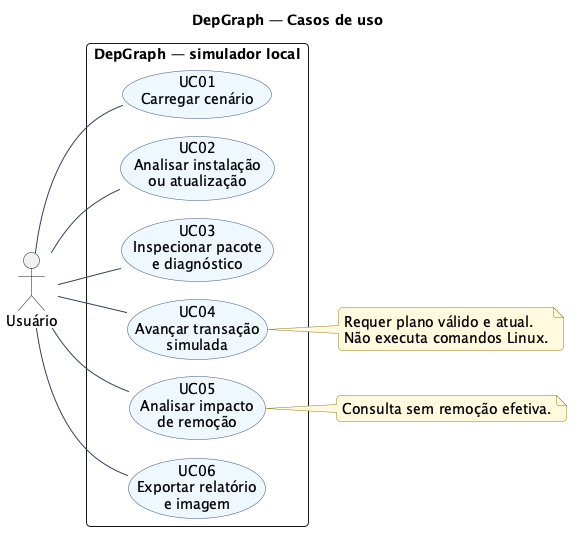
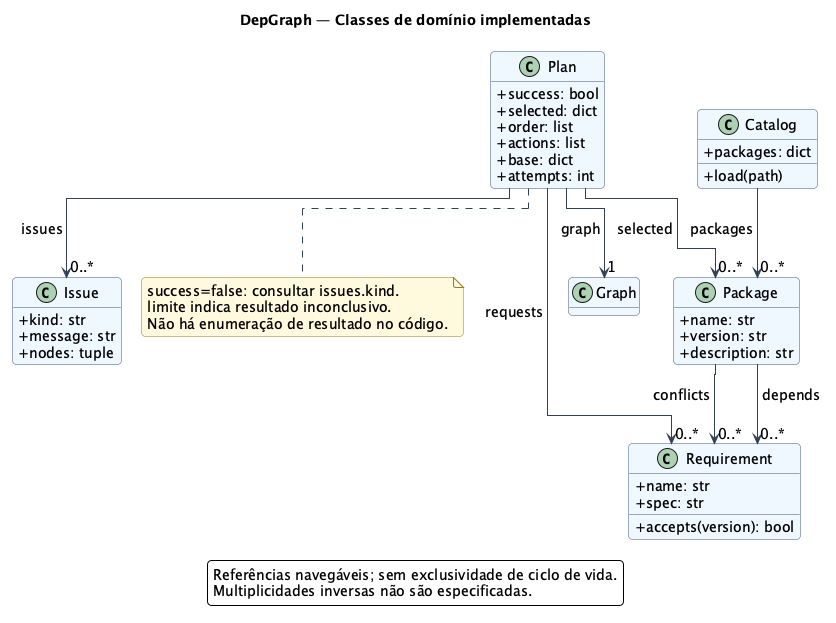
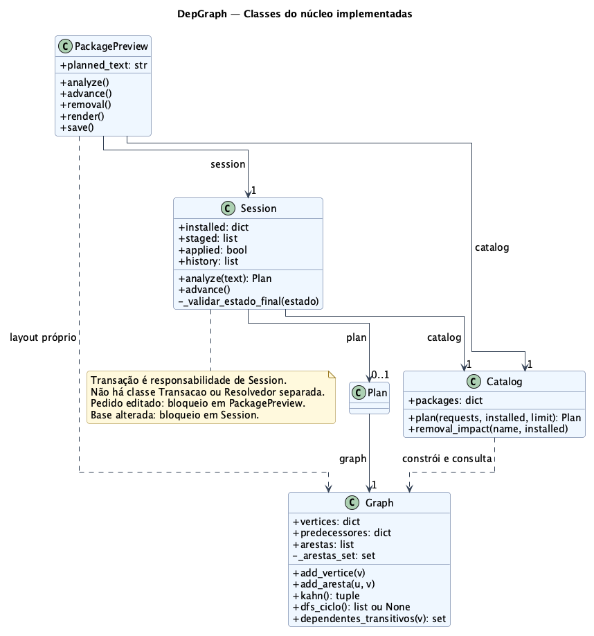
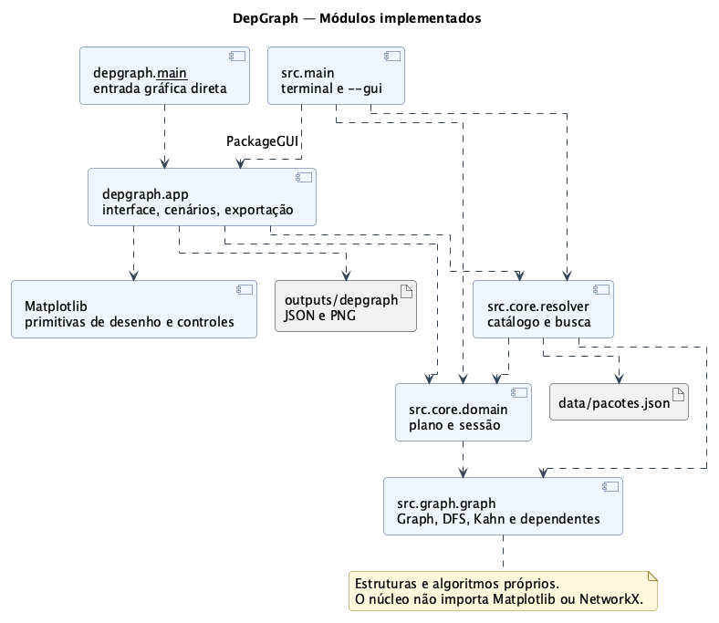
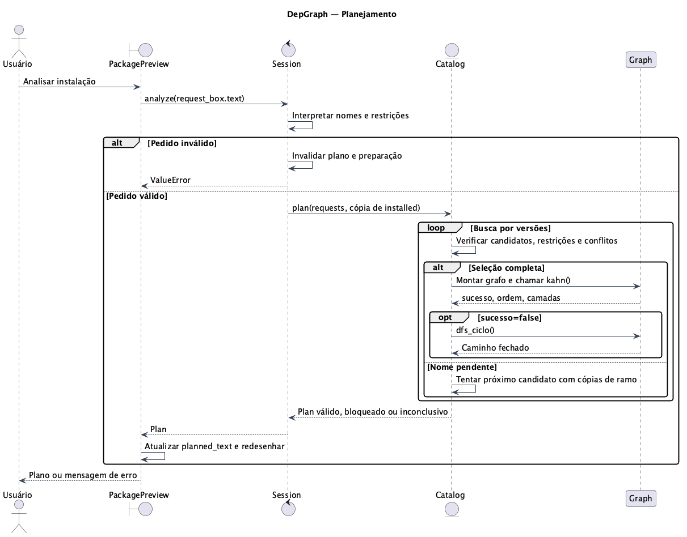
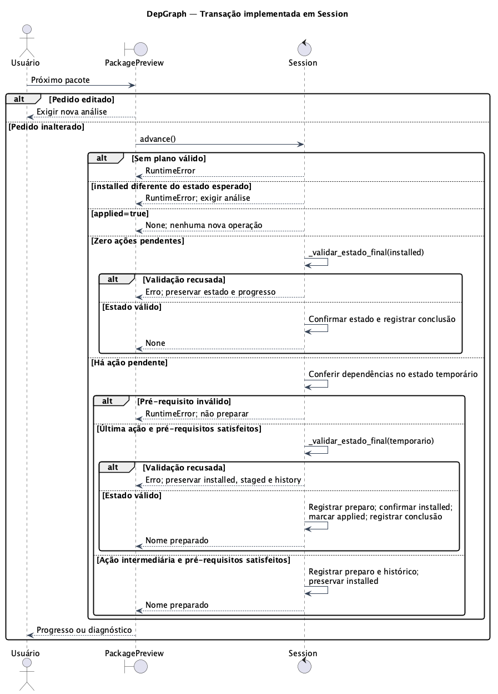
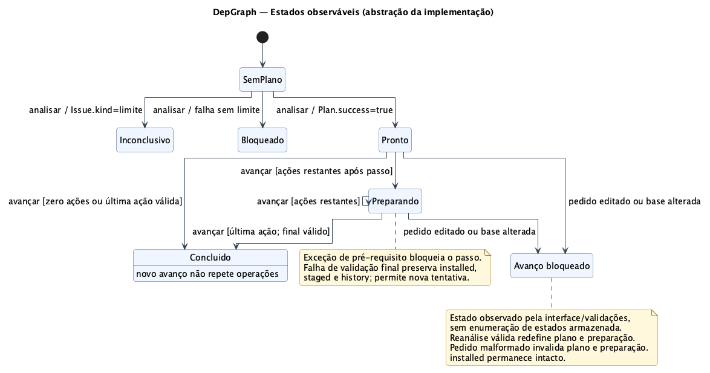
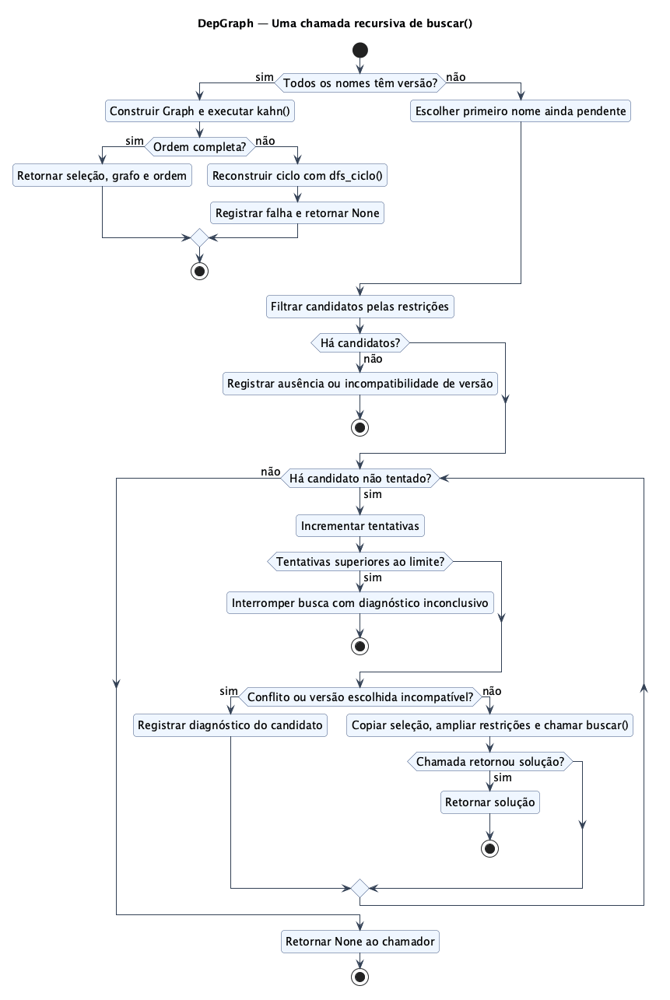

# DepGraph — Documentação completa da aplicação e da modelagem

Consolidação: **20/11/2026**. A interface em `depgraph/` utiliza o núcleo em `src/core/` e o grafo próprio em `src/graph/`. Este documento reúne escopo, requisitos, casos de uso, oito diagramas da implementação atual, contratos, dados, algoritmos e validação. As propostas arquiteturais anteriores permanecem em `historico/uml/`. Esta documentação não substitui o relatório LaTeX/SBC.

As fontes das figuras ficam em [uml/](uml/) e as imagens em [imagens/](imagens/). Os documentos temáticos continuam como fontes de manutenção dos respectivos assuntos; alterações neles devem ser refletidas nesta consolidação. Os diagramas PlantUML são a referência visual; os exemplos Mermaid anteriores são introdutórios.

## Sumário

1. [Contexto e escopo](#1-contexto-e-escopo)
2. [Modelo do problema e do grafo](#2-modelo-do-problema-e-do-grafo)
3. [Requisitos e regras](#3-requisitos-e-regras)
4. [Casos de uso detalhados](#4-casos-de-uso-detalhados)
5. [Arquitetura e oito diagramas UML](#5-arquitetura-e-oito-diagramas-uml)
6. [Cardinalidades e contratos](#6-cardinalidades-e-contratos)
7. [Dados de entrada e resultados](#7-dados-de-entrada-e-resultados)
8. [Algoritmos, correção e complexidade](#8-algoritmos-correção-e-complexidade)
9. [Rastreabilidade e validação](#9-rastreabilidade-e-validação)
10. [Execução e demonstração](#10-execução-e-demonstração)
11. [Evolução e entrega acadêmica](#11-evolução-e-entrega-acadêmica)
12. [Referências e manutenção](#12-referências-e-manutenção)

## 1. Contexto e escopo

O DepGraph aplica grafos ao tema Gestão de Conflitos em Sistemas de Dependência. Simula um gerenciador de pacotes: recebe pedidos de instalação ou atualização, considera um catálogo com várias versões e o estado já instalado, procura uma combinação compatível e calcula a precedência de instalação.

A interação ocorre em janela local. O usuário analisa o pedido, inspeciona o grafo e avança na preparação dos pacotes. A transação só modifica os instalados ao concluir toda a preparação e validar o estado final. A aplicação também consulta impacto de remoção e exporta resultados.

O catálogo atual é sintético, com 27 nomes e 32 versões. O cenário principal seleciona 17 pacotes, 26 relações de dependência e 15 novas instalações sobre dois pacotes inicialmente instalados. Esses números descrevem o exemplo do repositório, não um limite da arquitetura nem uma medição de desempenho.

Não há instalação real, download de pacotes, autenticação ou servidor. O ator externo é o usuário; o estado instalado é um mapa em memória. Comparação completa Debian/RPM, scripts, arquiteturas, pacotes virtuais, alternativas com `|` e remoção efetiva ficam fora do escopo inicial.

### Vocabulário

| Termo | Significado |
| --- | --- |
| Pacote no catálogo | Uma versão de um nome, acompanhada de metadados. |
| Requisito | Nome e condição que uma versão deve satisfazer. |
| Dependência | Requisito obrigatório para que outro pacote seja válido. |
| Incompatibilidade | Restrição que impede duas versões de coexistirem. |
| Seleção | Atribuição de uma versão por nome usada em uma tentativa de solução. |
| Plano | Resultado da análise, contendo seleção, grafo, ordem, operações ou diagnóstico. |
| Preparado | Pacote cuja operação foi simulada, ainda sem confirmação parcial nos instalados. |
| Confirmação | Aplicação do estado final validado à sessão. |
| Dependente | Pacote que precisa direta ou transitivamente de outro. |

## 2. Modelo do problema e do grafo

Sejam `C` o catálogo, `I` o mapa dos instalados e `P` a lista de pedidos. A busca tenta produzir uma seleção `S`, que associa cada nome a no máximo uma versão. O conjunto selecionado inclui os pacotes instalados preservados, os pedidos e todas as dependências necessárias.

Uma solução deve satisfazer simultaneamente:

1. A versão escolhida de cada pedido atende à restrição solicitada.
2. Toda dependência de uma versão selecionada aparece em `S` com uma versão aceita.
3. Nenhuma incompatibilidade declarada aplicável existe entre as versões selecionadas.
4. Nomes já instalados e não solicitados mantêm suas versões, respeitando também seus dependentes.
5. O grafo de precedência da seleção é acíclico na política didática adotada.

O grafo dirigido `G = (V, E)` possui um vértice por nome selecionado. Uma aresta `(A, B)` pertence a `E` quando B depende de A. A versão de A é informação do vértice; a restrição que B impõe a A é informação da relação. As arestas não têm pesos. Dependências compartilhadas não duplicam o vértice.

Uma ordenação topológica `T` deve satisfazer `posicao(A) < posicao(B)` para toda aresta `A → B`. Pode existir mais de uma ordem correta. A lista de operações é a subsequência de `T` que contém apenas nomes ausentes de `I` ou cuja versão selecionada difere da instalada.

**Exemplo conceitual:** se `editor` e `viewer` dependem de `libui`, o grafo contém `libui → editor` e `libui → viewer`. A biblioteca aparece uma vez e vem antes de ambos. Esse exemplo ilustra a orientação; não acrescenta nomes ao catálogo do projeto.

Se os dois aplicativos exigirem intervalos disjuntos de uma biblioteca, o pedido pode ser inviável mesmo sem ciclo. Por isso, resolução de versões e conflitos são verificações separadas da ordenação topológica.

## 3. Requisitos e regras

A situação de cada item é baseada no protótipo e na especificação registrada no repositório; não representa execução de testes nesta consolidação.

### Requisitos funcionais

| ID | Requisito e critério de aceitação | Situação |
| --- | --- | --- |
| RF01 | Carregar JSON de catálogo e estado instalado; rejeitar estrutura inválida, versões duplicadas equivalentes e estado inicial inconsistente com mensagem explicativa. | Implementado na aplicação atual. |
| RF02 | Receber um ou mais pedidos; rejeitar entrada vazia ou sintaxe inválida antes de executar operações. | Implementado na aplicação atual. |
| RF03 | Expandir dependências transitivas e selecionar uma versão por nome; toda dependência da solução deve existir e aceitar a versão selecionada. | Implementado na aplicação atual. |
| RF04 | Preservar versões instaladas de nomes ausentes do pedido; permitir mudança de nomes explicitamente solicitados, mantendo válidos os dependentes existentes. | Implementado na aplicação atual. |
| RF05 | Explorar versões alternativas; uma tentativa abandonada não pode deixar dependências residuais na solução. | Implementado na aplicação atual. |
| RF06 | Distinguir dependência ausente, restrições incompatíveis, conflito declarado e ciclo; falhas não podem disponibilizar operações de instalação. | Implementado na aplicação atual. |
| RF07 | Produzir ordem topológica; para toda aresta A → B, A deve preceder B. Mostrar um caminho fechado real quando houver ciclo. | Implementado com Kahn e DFS próprios. |
| RF08 | Preparar um pacote por avanço; verificar pré-requisitos e manter o estado instalado intacto durante a preparação parcial. | Implementado na aplicação atual. |
| RF09 | Confirmar o estado final somente após validação integral; concluir sem alterações quando o plano não tiver operações. | Implementado na aplicação atual. |
| RF10 | Impedir avanço após mudança de pedido ou estado instalado; exigir nova análise e descartar preparação anterior ao replanejar. | Existe, com verificação do pedido na interface; centralizar no núcleo proposto. |
| RF11 | Calcular dependentes diretos e transitivos de um pacote instalado e ordem de remoção em cascata; a consulta não altera o estado. | Implementado com busca própria. |
| RF12 | Visualizar dependências, versões, diagnósticos e dados de um vértice selecionado. | Implementado na aplicação atual. |
| RF13 | Exportar relatório JSON e imagem PNG; informar falhas de escrita ao usuário. | Implementado na aplicação atual. |
| RF14 | Interromper busca ao atingir limite e informar resultado inconclusivo, sem afirmar inexistência de solução. | Implementado na aplicação atual. |

### Regras do domínio

- **RD01 — Direção:** A → B significa que B depende de A. Conflitos são restrições separadas das arestas de precedência.
- **RD02 — Versões:** de um a três componentes numéricos, comparados numericamente. `1`, `1.0` e `1.0.0` são equivalentes.
- **RD03 — Restrições:** o modelo aceita intervalos com condições combinadas. A entrada textual atual de pedidos aceita uma condição por item separado por vírgula; não presumir suporte ao mesmo formato de intervalo nessa entrada.
- **RD04 — Política de busca:** preferir versões mais altas e retornar uma solução viável. Não há garantia de solução ótima, atualização mínima ou menor volume de download.
- **RD05 — Conflitos:** basta que uma das versões declare uma incompatibilidade aplicável à outra para impedir coexistência.
- **RD06 — Ciclos:** rejeitar ciclos por exigir precedência estrita, mesmo que gerenciadores reais adotem outras regras.
- **RD07 — Estado preservado:** todos os pacotes instalados participam da validação; não remover automaticamente um pacote para viabilizar o pedido.
- **RD08 — Diagnóstico:** uma falha de busca pode mostrar uma tentativa representativa; não equivale a enumerar todas as causas possíveis.

### Requisitos técnicos e acadêmicos

| ID | Critério |
| --- | --- |
| RN01 | Usar estrutura de grafo e processamento próprios na versão final; NetworkX fica isolado no protótipo ou em comparações de desempenho. |
| RN02 | Executar o núcleo sem janela, permitindo testes e experimentos independentes da interface. |
| RN03 | Implementar Kahn, DFS e busca de dependentes em O(V + E), sem alterar o grafo original durante análise. Medir o backtracking separadamente, pois pode ser exponencial. |
| RN04 | Registrar fontes dos dados, transformação, ambiente, sementes e repetições dos experimentos; não apresentar catálogo sintético como dados reais de Linux. |
| RN05 | Manter interface gráfica, UML coerente com o código e contribuições individuais identificáveis no Git. |
| RN06 | Produzir relatório LaTeX/SBC de 12–15 páginas, slides, apresentação de 10 minutos, vídeo de 12–18 minutos e pacote de entrega conforme o enunciado. |

### Evidências a produzir

Os testes de referência estão em [test_packages.py](../../tests/test_packages.py). A suíte preserva os cenários e inclui testes específicos da estrutura própria: grafo vazio, vértice isolado, laço, componentes desconexas, ciclo com dependentes externos e invariância do grafo após as consultas.

Na revisão final, verificar RF01–RF14 com testes ou demonstrações reproduzíveis. Para RN03, registrar análise dos algoritmos e medições efetivas. Para RN05–RN06, conferir os artefatos entregues. Ainda não há uma matriz completa de resultados da versão final.

### Fora do escopo inicial

Instalação real, downloads, scripts de manutenção, pacotes virtuais, múltiplas arquiteturas, sintaxe completa Debian/RPM, dependências opcionais, alternativas com `|`, remoção efetiva e resolução automática por desinstalação. Persistência de estado entre execuções não é requisito atual; exportar relatório não equivale a salvar e restaurar uma sessão.

## 4. Casos de uso detalhados

### UC01 — Carregar cenário

**Requisitos:** RF01, RF02. **Pré-condição:** catálogo válido disponível.

1. O usuário escolhe um cenário de demonstração.
2. A aplicação restaura a base instalada do cenário e descarta a sessão anterior.
3. Preenche o pedido, analisa e apresenta o resultado.

**Resultado:** nova sessão de demonstração. Catálogo ou estado inválido deve gerar erro explicativo. A restauração da base é própria da demonstração, não uma desinstalação real.

### UC02 — Analisar instalação ou atualização

**Requisitos:** RF02–RF07, RF10, RF14. **Pré-condição:** catálogo e estado instalado válidos.

1. O usuário informa nomes de pacotes e restrições opcionais e solicita análise.
2. A aplicação valida a entrada e registra pedido e estado usados no planejamento.
3. O resolvedor fixa os instalados não solicitados, expande dependências e tenta versões compatíveis.
4. Para uma atribuição completa, verifica a precedência e produz ordem topológica.
5. Mostra versões selecionadas, operações necessárias e grafo.

**Alternativas:** entrada inválida impede análise; falta de solução gera diagnóstico e bloqueia execução; limite de busca gera resultado inconclusivo. Um ciclo em uma tentativa permite tentar outra versão, quando houver candidatos.

**Resultado:** plano válido ou diagnóstico, sem alterar o estado instalado. Uma nova análise válida como entrada reinicia o progresso anterior. O plano pode conter zero operações se o pedido já estiver atendido.

### UC03 — Inspecionar pacote e diagnóstico

**Requisito:** RF12. **Pré-condição:** resultado de análise visível.

1. O usuário seleciona um vértice.
2. A aplicação mostra os metadados disponíveis, dependências e restrições relacionadas.
3. Em caso de falha, apresenta o diagnóstico associado ao resultado.

**Resultado:** consulta sem alteração de estado. Um nó de dependência ausente pode não ter metadados de pacote disponíveis.

### UC04 — Avançar transação simulada

**Requisitos:** RF08–RF10. **Pré-condição:** plano válido referente ao pedido e ao estado atuais.

1. O usuário solicita o próximo passo.
2. A aplicação verifica a validade do plano e os pré-requisitos da próxima operação no estado temporário.
3. Registra o pacote como preparado e atualiza o progresso.
4. Ao preparar a última operação, valida o estado final completo e confirma a transação em memória.

**Alternativas:** plano ausente, bloqueado ou desatualizado impede avanço; falha de pré-requisito ou validação impede confirmação; plano sem operações conclui sem alterar os instalados; avançar após conclusão não repete operações.

**Resultado:** durante preparação parcial, instalados intactos; após confirmação, estado final válido. A ação de reiniciar plano corresponde a uma nova análise, descartando a preparação parcial.

### UC05 — Analisar impacto de remoção

**Requisito:** RF11. **Pré-condição:** nome de um pacote instalado informado.

1. O usuário solicita a análise de impacto.
2. A aplicação percorre os dependentes no grafo do estado instalado.
3. Exibe o conjunto afetado e uma ordem de remoção que coloca dependentes antes das dependências.

**Alternativa:** nome não instalado gera erro explicativo.

**Resultado:** relatório de impacto; nenhum pacote é removido. O conjunto de dependentes exclui o pacote consultado; a ordem sugerida inclui esse pacote.

### UC06 — Exportar relatório e imagem

**Requisito:** RF13. **Pré-condição:** resultado de análise disponível.

1. O usuário solicita exportação.
2. A aplicação escreve o relatório JSON e uma imagem PNG da visualização.
3. Informa o destino ou o erro de escrita.

**Resultado:** arquivos para consulta e documentação. O relatório identifica pedido analisado e texto editado; exportar um resultado não autoriza executá-lo se estiver desatualizado. A exportação atual não garante atomicidade entre os dois arquivos: uma falha pode deixar apenas um deles gravado.

## 5. Arquitetura e oito diagramas UML

### 1. Casos de uso



[Fonte](uml/01-casos-de-uso.puml) · [SVG](imagens/01-casos-de-uso.svg)

Seis objetivos do usuário: carregar cenário, analisar instalação/atualização, inspecionar, avançar simulação, consultar remoção e exportar. O usuário é o único ator. Não há instalação real nem remoção efetiva. As especificações textuais estão em [casos-de-uso.md](casos-de-uso.md).

### 2. Classes de domínio



[Fonte](uml/02-classes-dominio.puml) · [SVG](imagens/02-classes-dominio.svg)

`Requirement`, `Package`, `Catalog`, `Plan` e `Issue` correspondem às classes em `src/core/`. `Plan.graph` referencia o `Graph` próprio. `success=false` representa falha ou resultado inconclusivo: consultar `issues.kind`, especialmente `limite`. Não existe a enumeração `ResultadoPlano` da proposta anterior.

As sete multiplicidades de destino representam as coleções e a referência única ao grafo. São associações navegáveis, sem exclusividade de propriedade ou ciclo de vida. A coleção `requests` é desenhada como `0..*` porque a classe pode ser construída programaticamente com lista vazia; a entrada textual da interface exige ao menos um pedido. Multiplicidades inversas não especificadas não afirmam exclusividade.

### 3. Classes do núcleo



[Fonte](uml/03-classes-nucleo.puml) · [SVG](imagens/03-classes-nucleo.svg)

`Catalog` reúne carga, resolução e análise de remoção. `Session` administra estado e valida a transação. `PackagePreview` mantém uma sessão e o catálogo. Uma sessão pode estar sem plano, e cada plano possui um grafo. Não foram inventadas classes separadas `Resolvedor`, `Transacao` e `AnaliseRemocao`. A mudança de pedido é bloqueada pela interface; alteração da base é bloqueada pela sessão.

As cinco multiplicidades de destino são referências mantidas pelos objetos. Dependências tracejadas indicam construção e consulta, sem multiplicidade de propriedade.

### 4. Componentes e arquivos



[Fonte](uml/04-componentes.puml) · [SVG](imagens/04-componentes.svg)

A CLI `python -m src.main` e a entrada gráfica `python -m depgraph` compartilham o domínio, o resolvedor e o grafo em `src/`. A interface Matplotlib em `depgraph/app.py` apresenta o resultado e carrega o catálogo `data/pacotes.json` pelo resolvedor.

### 5. Planejamento



[Fonte](uml/05-sequencia-planejamento.puml) · [SVG](imagens/05-sequencia-planejamento.svg)

A interface chama `Session.analyze`, que interpreta a entrada e pede um plano ao catálogo. A resolução é recursiva e copia a seleção e os requisitos a cada ramo. Atribuição completa permite executar Kahn; um ciclo produz diagnóstico com caminho da DFS. Limite de recursos significa inconclusão. A análise não modifica os instalados.

`Session.analyze` redefine a preparação. Uma entrada textual inválida invalida o plano e preserva os instalados. A interface exige nova análise após a edição do pedido.

### 6. Preparação e confirmação



[Fonte](uml/06-sequencia-transacao.puml) · [SVG](imagens/06-sequencia-transacao.svg)

Cada avanço prepara no máximo uma operação. Antes da última preparação, a sessão valida o estado final completo. Se a validação falhar, instalados, progresso e histórico permanecem como antes do passo; uma tentativa posterior não pula a operação recusada. Após validação, a sessão registra o último preparo e confirma o estado. Pedidos sem operações validam o estado atual e concluem sem alterar os instalados.

Plano inválido, pedido editado, base alterada e pré-requisito ausente bloqueiam o avanço. Depois da conclusão, novo avanço retorna sem repetir operações.

### 7. Estados observáveis



[Fonte](uml/07-estados.puml) · [SVG](imagens/07-estados.svg)

Sem plano, bloqueado, inconclusivo, pronto, preparando e concluído são situações derivadas de `plan`, `success`, `issues`, `staged` e `applied`. O desenho não representa uma máquina de estados armazenada no código. Uma reanálise redefine a preparação. Um pedido malformado invalida o plano. A vista resume transições relevantes e documenta reanálise em nota, sem enumerar todas as transições entre cada resultado possível.

### 8. Atividade da resolução



[Fonte](uml/08-atividade-resolucao.puml) · [SVG](imagens/08-atividade-resolucao.svg)

O desenho representa uma chamada de `search`, com retornos ao chamador. A pilha é a pilha de chamadas Python, e não uma estrutura explícita implementada no resolvedor. A DFS de ciclos, separadamente, é iterativa. Candidatos são tentados do maior para o menor; dependências abandonadas não vazam para outros ramos.

## 6. Cardinalidades e contratos

As classes de domínio têm sete multiplicidades explícitas, e as classes do núcleo, cinco. Todas estão na extremidade de destino. Associações descrevem referências; não representam composição exclusiva. As multiplicidades inversas são omitidas.

| Origem | Destino / atributo | Quantidade |
| --- | --- | --- |
| Catalog | Package / packages | 0..* |
| Package | Requirement / depends | 0..* |
| Package | Requirement / conflicts | 0..* |
| Plan | Requirement / requests | 0..* |
| Plan | Package / selected | 0..* |
| Plan | Issue / issues | 0..* |
| Plan | Graph / graph | 1 |
| PackagePreview | Session / session | 1 |
| PackagePreview | Catalog / catalog | 1 |
| Session | Catalog / catalog | 1 |
| Session | Plan / plan | 0..1 |

`Plan → Graph` aparece nas duas vistas como a mesma relação. `requests` pode ser vazio numa instância construída por código; a entrada textual exige ao menos um pedido.

| Operação real | Contrato |
| --- | --- |
| Catalog.load(path) | Lê o JSON, indexa as versões por nome e retorna o catálogo e o mapa de instalados. |
| Catalog.plan(requests, installed, limit) | Usa a base para buscar seleção compatível e retorna plano válido, bloqueado ou inconclusivo. |
| Graph.kahn() | Retorna `(True, ordem, camadas)` ou `(False, None, None)`. |
| Graph.dfs_ciclo() | Retorna `None` em grafo acíclico ou um caminho fechado real. |
| Catalog.removal_impact(name, installed) | Retorna dependentes e ordem inversa; não aplica remoção. |
| Session.analyze(text) | Substitui plano e limpa preparo. Um pedido inválido invalida o plano. |
| Session.advance() | Confere pré-requisitos; prepara uma operação; valida antes de confirmar o último passo. Uma recusa preserva estado, progresso e histórico daquele passo. |
| PackagePreview.advance() | Exige texto igual ao pedido analisado antes de chamar a sessão. |

As coleções de `Plan` e `Graph` são públicas e mutáveis no código atual. Os consumidores devem tratá-las como resultados de análise e não editá-las durante a execução. Imutabilidade e encapsulamento adicionais são melhorias futuras, não garantias implementadas.

O estado temporário soma versões instaladas às operações já preparadas. Confirmação só ocorre após validação completa. Pedidos sem ações validam o estado atual e concluem; reanálise que retorna novo plano descarta preparação anterior. O histórico registra apenas operações aceitas.

## 7. Dados de entrada e resultados

### Catálogo JSON

O formato atual usa `pacotes` como lista de versões e `instalados` como mapa. Cada dependência ou conflito contém `nome` e, opcionalmente, `versao`; a ausência da restrição representa aceitação de qualquer versão disponível.

Exemplo mínimo válido, reduzido a nomes existentes no catálogo:

```json
{
  "descricao": "Exemplo reduzido de catálogo sintético",
  "instalados": {"base-files": "1.0"},
  "pacotes": [
    {
      "nome": "base-files",
      "versao": "1.0",
      "descricao": "Base do sistema simulado",
      "depende": [],
      "conflita": []
    },
    {
      "nome": "libcore",
      "versao": "1.0",
      "descricao": "Biblioteca compartilhada",
      "depende": [{"nome": "base-files", "versao": ">=1.0"}],
      "conflita": []
    }
  ]
}
```

O catálogo completo está em [pacotes.json](../../data/pacotes.json). Não é um espelho de uma distribuição Linux. A validação aceita dependências ausentes no catálogo para permitir cenários de erro; o resolvedor deve diagnosticá-las ao analisar um pedido afetado. Já o estado inicialmente instalado precisa ser consistente.

Nomes seguem o padrão `[a-z0-9][a-z0-9+.-]*`. Versões têm um a três componentes numéricos, normalizados para comparação: `1.10` é maior que `1.9`. As restrições aceitam `=`, `==`, `>`, `>=`, `<` e `<=`; o modelo de requisitos permite combinar condições como `>=1.0,<2.0`.

A caixa de pedidos atual usa vírgulas para separar itens e aceita uma condição por item. Exemplo: `modern-browser, libcore>=2.0`. Não confundir essa entrada com o formato de intervalos usado nos metadados JSON.

### Relatório e imagem da simulação

O protótipo grava `outputs/depgraph/pacotes.json` e `pacotes.png`. O relatório registra:

| Grupo | Campos atuais |
| --- | --- |
| Pedido e validade | `pedido`, `pedido_editado`, `plano_valido` |
| Estado e solução | `instalados`, `selecionados`, `ordem_instalacao` |
| Progresso | `preparados`, `transacao_concluida`, `historico` |
| Explicação da busca | `tentativas`, `diagnosticos` com tipo e mensagem |

No relatório atual, `ordem_instalacao` contém as operações necessárias, e não todos os vértices preservados da ordem topológica. `plano_valido: false` pode representar bloqueio ou busca inconclusiva; consultar o diagnóstico. A representação atual usa `success` e `issues.kind`; não existe enumeração de resultados.

Os arquivos são resultados de consulta, não um mecanismo de restauração da sessão. As duas gravações não são atômicas: um erro pode deixar apenas um arquivo produzido. Erros de escrita devem ser mostrados ao usuário.

## 8. Algoritmos, correção e complexidade

### Resolução de versões por backtracking

Acumular os pedidos e as versões fixas dos instalados não solicitados. Escolher um nome ainda sem atribuição, filtrar versões que atendem às condições conhecidas e explorar candidatos da maior versão para a menor. Cada escolha adiciona suas dependências ao ramo correspondente.

Ao encontrar restrição violada ou conflito, abandonar o ramo. Ao completar uma atribuição, construir o grafo e verificar a precedência. Um ciclo também pode levar ao retrocesso e à tentativa de outra versão. Dependências de escolhas abandonadas não podem permanecer na solução seguinte.

O raciocínio de correção depende de três propriedades: cada ramo representa suas próprias escolhas; a validação rejeita atribuições inválidas; uma solução só é aceita quando todos os requisitos e a precedência são satisfeitos. Com busca finita exaustiva e sem interrupção, esgotar os candidatos demonstra ausência de solução dentro da política. Com limite atingido, a conclusão correta é inconclusiva.

### Kahn para ordenação topológica

Copiar graus de entrada, enfileirar vértices com grau zero e remover um por vez da fila FIFO, reduzindo os graus dos sucessores na cópia. Um sucessor entra na fila apenas ao atingir zero. Se a quantidade processada for menor que `|V|`, não há ordem completa.

O invariante é que um vértice só é emitido após todos os seus predecessores. A consulta não altera as adjacências originais. Vértices restantes podem ser membros de ciclos ou apenas seus dependentes; usar DFS para identificar um ciclo concreto.

### DFS para reconstrução de ciclo

Percorrer todas as componentes com estados branco, cinza e preto. Uma aresta para vértice cinza fecha um caminho na pilha ativa. Usar predecessores para reconstruir esse caminho e repetir o primeiro vértice ao final. Um laço deve produzir um ciclo fechado com o mesmo nome nas duas extremidades.

### Dependentes e remoção

Percorrer sucessores do nome consultado com conjunto de visitados. Como as arestas vão da dependência ao dependente, esse percurso encontra os afetados. O conjunto de dependentes exclui o próprio nome consultado; a ordem sugerida de remoção inclui esse nome e usa a ordem topológica inversa do conjunto afetado. O estado não é alterado.

### Custos esperados

| Componente | Tempo | Espaço |
| --- | --- | --- |
| Adjacência do grafo | Construção O(V + E) | O(V + E) |
| Kahn com fila | O(V + E) | Auxiliar O(V) |
| DFS com caminho | O(V + E) | Auxiliar O(V) |
| Busca de dependentes | O(V + E) no pior caso | Auxiliar O(V) |
| Resolução de versões | Pode ser exponencial nas combinações de versões | Depende da estratégia de ramos e cópias de requisitos |

As três primeiras consultas de grafo não tornam linear o resolvedor completo. Medir separadamente leitura, resolução, ordenação, detecção de ciclos e desenho. A atividade apresenta uma pilha conceitual; uma implementação que materialize todos os ramos pode usar mais memória que outra que gere candidatos sob demanda.

## 9. Rastreabilidade e validação

A matriz abaixo relaciona comportamento, vista principal e evidência a verificar. É um plano de validação, não um registro de aprovação da versão final.

| Requisitos | Casos de uso / vistas | Evidência esperada |
| --- | --- | --- |
| RF01–RF02 | UC01–UC02; domínio e sequência de planejamento | Entradas inválidas rejeitadas e base inicial consistente. |
| RF03–RF05 | UC02; classes do núcleo e atividade | Fechamento transitivo, uma versão por nome, atualização explícita e alternativa sem resíduos. |
| RF06–RF07 | UC02–UC03; planejamento e estados | Diagnósticos distintos, caminho real de ciclo e ordem válida para todas as arestas. |
| RF08–RF10 | UC04; sequência de transação e estados | Instalados intactos durante preparação, confirmação final e bloqueio de plano desatualizado. |
| RF11 | UC05; núcleo e componentes | Dependentes corretos, ordem inversa e ausência de remoção efetiva. |
| RF12–RF13 | UC03 e UC06; casos de uso e componentes | Inspeção visual, JSON coerente, PNG legível e erro de escrita apresentado. |
| RF14 | UC02; planejamento, atividade e estados | Limite produz inconclusivo e nenhuma operação executável. |
| RN01–RN03 | Núcleo e componentes | Algoritmos próprios, núcleo sem janela e análise de custos compatível com o código. |
| RN04–RN06 | Documentação e materiais de entrega | Origem dos dados, experimentos reproduzíveis, UML atualizada e materiais acadêmicos completos. |

Complementar os cenários de referência com grafo vazio, vértice isolado, laço, ciclo desconexo e ciclo com dependentes externos. Validar ordem pelas relações de precedência, sem impor uma única sequência possível. Para transações, incluir zero operações, uma operação, falha intermediária, reinício, alteração de pedido, alteração de base e avanço após conclusão.

Os testes atuais estão em [test_packages.py](../../tests/test_packages.py) e [test_preview.py](../../prototypes/networkx_preview/test_preview.py). A segunda suíte cobre o exemplo histórico de tarefas; seus resultados não representam cobertura adicional do núcleo final de pacotes.

Nos experimentos, variar nomes, versões por nome, quantidade de arestas, compartilhamento e tipos de conflito. Fixar sementes, registrar ambiente e versões, repetir medições e reportar dispersão. Comparações com NetworkX devem ficar isoladas do funcionamento final. Há 294 medições de tempo, nove de memória, tabelas e gráfico no [protocolo experimental](../experimentos/README.md). A suíte final contém 41 testes e o oráculo reproduzível conferiu 4.627 grafos sem divergência.

As figuras foram renderizadas e revisadas conforme o [registro de revisão](revisao-dos-diagramas.md). Essa verificação cobre os artefatos de modelagem, não executa testes da aplicação.

## 10. Execução e demonstração

A aplicação requer Python 3.9 ou superior e Matplotlib, declarado em [requirements.txt](../../requirements.txt). NetworkX não integra suas dependências.

Na raiz do repositório:

```bash
python3 -m venv .venv
source .venv/bin/activate
python -m pip install -r requirements.txt
python -m depgraph
```

Para percorrer os principais resultados:

| Cenário | Resultado demonstrado |
| --- | --- |
| `desktop` | Plano viável com dependências compartilhadas. |
| `versoes` | Restrições de versão incompatíveis. |
| `conflito` | Incompatibilidade declarada entre pacotes. |
| `ausente` | Dependência inexistente no catálogo. |
| `ciclo` | Dependência circular. |
| `upgrade` | Atualização explicitamente solicitada. |
| `instalado` | Bloqueio por preservar uma versão instalada. |
| `alternativa` | Retrocesso para outra versão viável. |

Exemplo de seleção de cenário e comando de testes, a executar no ambiente preparado:

```bash
python -m depgraph --cenario versoes
MPLBACKEND=Agg python scripts/verificar.py
```

Uma demonstração pode começar com o plano `desktop`, preparar um pacote e mostrar que os instalados ainda não mudaram, concluir e inspecionar o resultado. Em seguida, comparar incompatibilidade de versões com ciclo e mostrar a alternativa viável. A análise de remoção e a exportação encerram o percurso. Ao trocar de cenário, o protótipo restaura sua base de demonstração.

## 11. Evolução e entrega acadêmica

| Etapa | Resultado esperado |
| --- | --- |
| Grafo próprio | Listas de adjacência, Kahn, DFS e dependentes validados isoladamente. |
| Separação adicional (opcional) | Extrair responsabilidades de Catalog e Session se houver necessidade de manutenção. |
| Integração | Implementada em depgraph, com layout e processamento próprios. |
| Validação | Preservar os cenários, acrescentar casos de borda e realizar experimentos reproduzíveis. |
| Documentação final | Ajustar UML aos nomes e APIs efetivamente implementados e registrar responsabilidades reais. |
| Entrega | Relatório SBC de 12–15 páginas, slides, apresentação de 10 minutos, vídeo de 12–18 minutos e pacote exigido pelo enunciado. |

O planejamento acadêmico completo está em [agent.md](../../agent.md), referenciado ao [TP.pdf](../../TP.pdf). Confirmar prazo e procedimentos no Canvas. Não atribuir responsabilidades ou contribuições fictícias; registrar as tarefas e os commits efetivos de cada integrante. Cada membro deve cumprir sua própria entrega.

O relatório deve explicar o problema, a modelagem, os algoritmos, a correção, os custos, os dados, os experimentos e as limitações. Escolher figuras legíveis dentro do limite de páginas; esta documentação técnica não precisa ser copiada integralmente para o relatório.

## 12. Referências e manutenção

| Artefato | Uso |
| --- | --- |
| [Modelagens principais](modelagens-principais.md) | Galeria e explicações das oito vistas. |
| [Requisitos](requisitos.md) e [casos de uso](casos-de-uso.md) | Especificação temática de comportamentos e critérios. |
| [Arquitetura](arquitetura.md) e [comportamento](comportamento.md) | Comparação com classes atuais e vistas introdutórias. |
| [Guia de notação](guia-de-notacao.md) | Leitura e escrita de UML, Mermaid e PlantUML. |
| [Revisão](revisao-dos-diagramas.md) | Conferência das relações, cardinalidades e correções visuais. |
| [Guia do protótipo](../prototipo-networkx/README.md) | Interface atual e imagens dos cenários. |
| [Gerador das figuras](gerar_diagramas.py) | Reprodução local dos PNGs e SVGs. |

As referências oficiais de sintaxe e semântica estão no guia de notação. O conjunto de figuras usa PlantUML 1.2026.4; o comando e o hash do JAR estão na seção de reprodução junto aos diagramas. Não é necessário baixar dependências para simplesmente ler as imagens incluídas.

Ao mudar uma regra, atualizar os requisitos e casos de uso afetados, os contratos, as fontes `.puml` e esta consolidação; regenerar as figuras e revisar o resultado visual. Ao mudar apenas o layout, preservar a semântica das relações e conferir cardinalidades e rótulos. Registrar separadamente revisão de documentos, renderização, execução de testes e medições para manter claras as evidências disponíveis.

