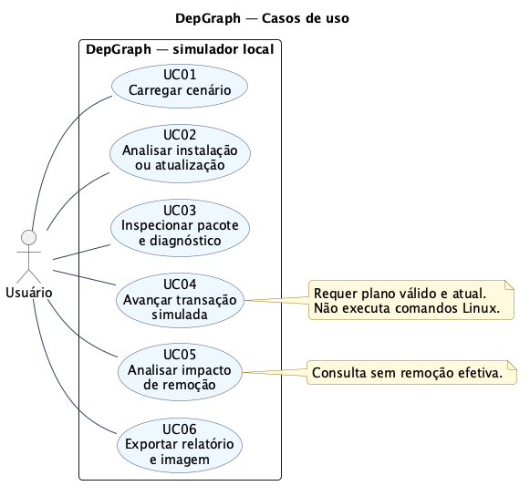
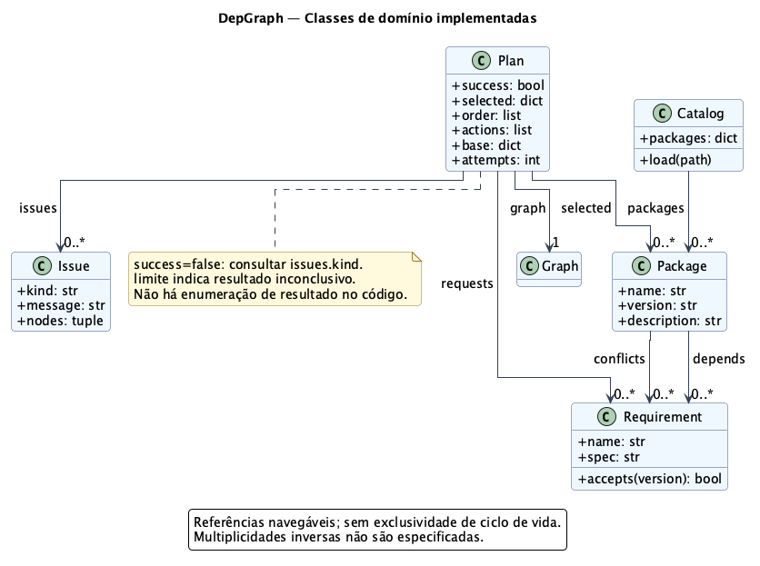
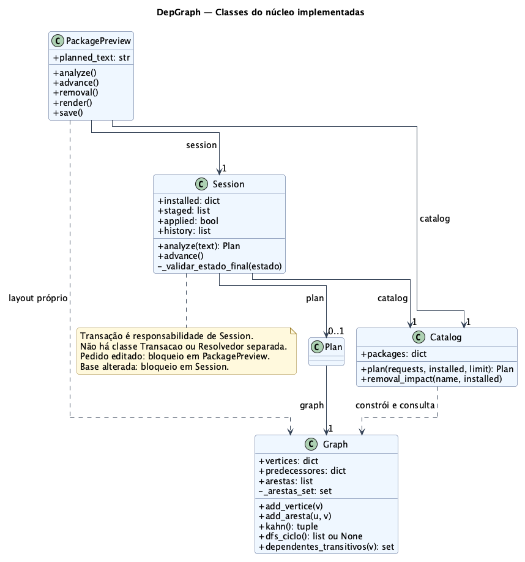
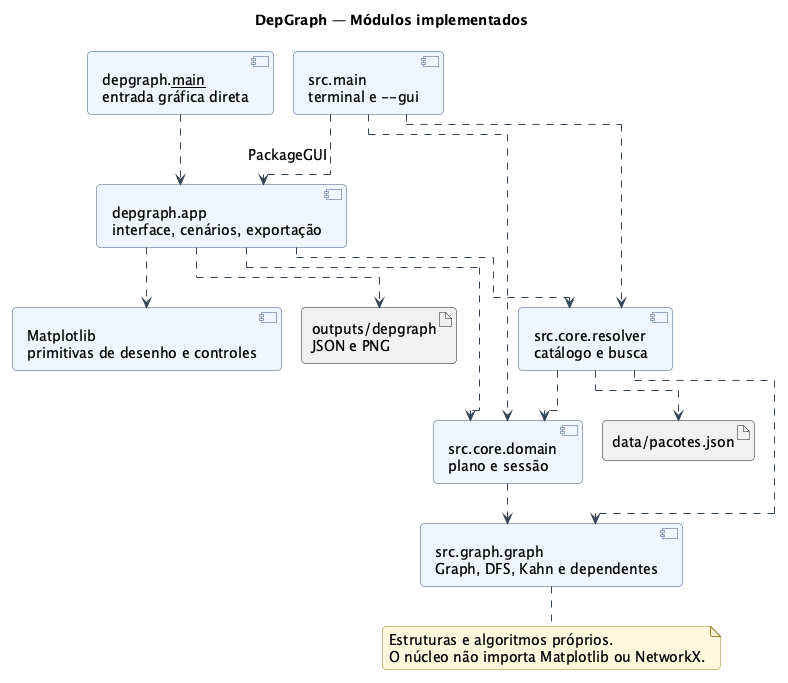
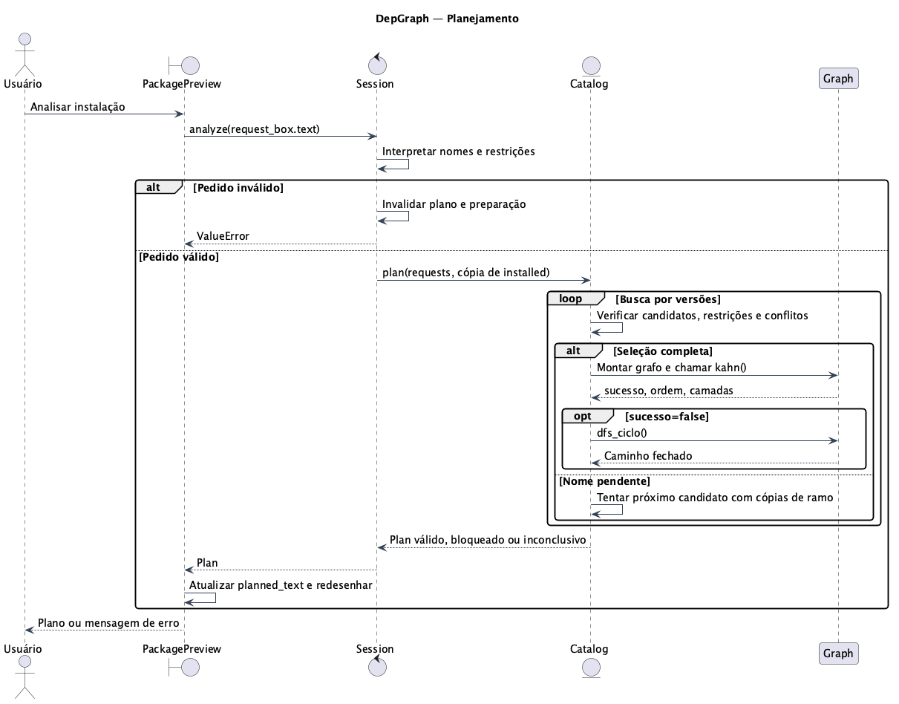
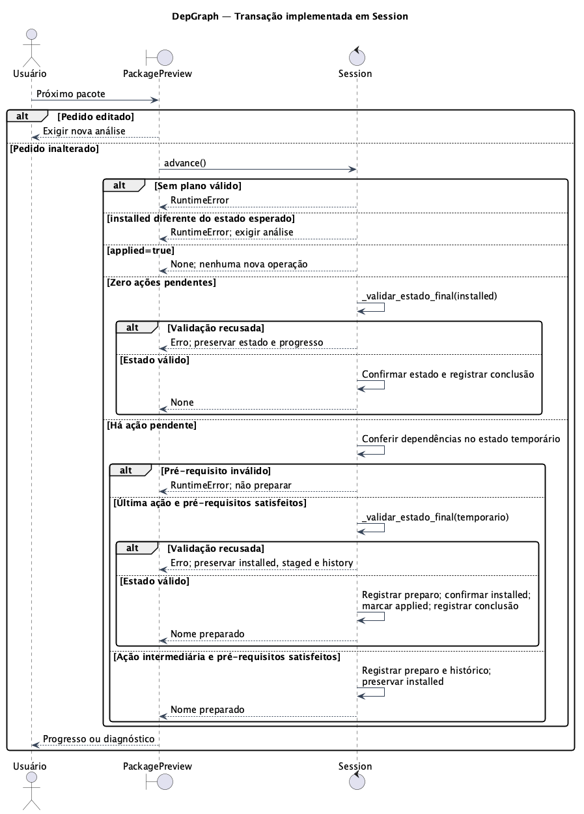
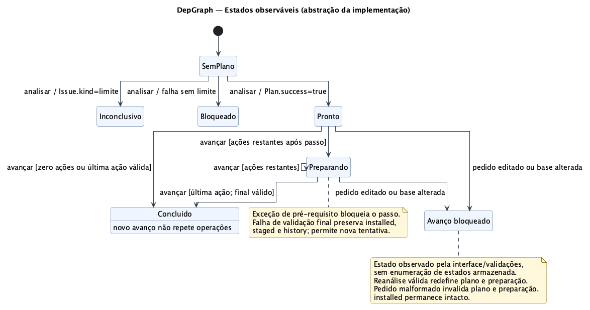
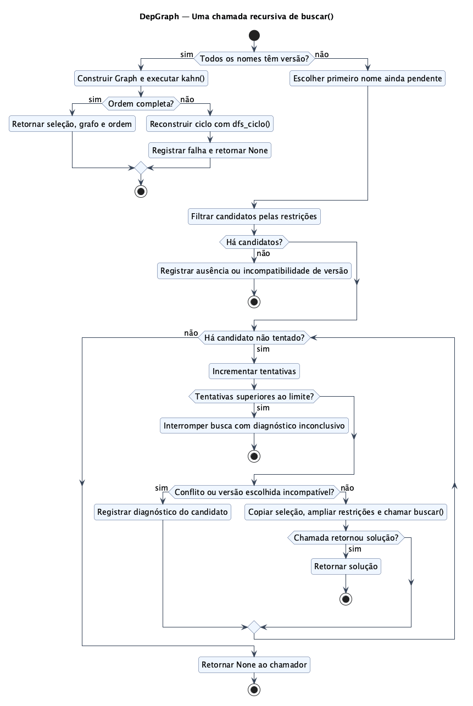

# Principais modelagens do DepGraph

Revisão de 20/11/2026. As oito figuras abaixo descrevem a interface em `depgraph/` e o núcleo integrado em `src/`. Nomes de classes e métodos seguem o código. Estados e atividades são abstrações explicativas: não implicam a existência de classes ou enumerações adicionais.

As propostas arquiteturais anteriores foram preservadas em [historico/uml](historico/uml/), incluindo seu estilo de renderização. Elas não representam a estrutura entregue. As fontes atuais estão em [uml](uml/).

## 1. Casos de uso



[Fonte](uml/01-casos-de-uso.puml) · [SVG](imagens/01-casos-de-uso.svg)

Seis objetivos do usuário: carregar cenário, analisar instalação/atualização, inspecionar, avançar simulação, consultar remoção e exportar. O usuário é o único ator. Não há instalação real nem remoção efetiva. As especificações textuais estão em [casos-de-uso.md](casos-de-uso.md).

## 2. Classes de domínio



[Fonte](uml/02-classes-dominio.puml) · [SVG](imagens/02-classes-dominio.svg)

`Requirement`, `Package`, `Catalog`, `Plan` e `Issue` correspondem às classes em `src/core/`. `Plan.graph` referencia o `Graph` próprio. `success=false` representa falha ou resultado inconclusivo: consultar `issues.kind`, especialmente `limite`. Não existe a enumeração `ResultadoPlano` da proposta anterior.

As sete multiplicidades de destino representam as coleções e a referência única ao grafo. São associações navegáveis, sem exclusividade de propriedade ou ciclo de vida. A coleção `requests` é desenhada como `0..*` porque a classe pode ser construída programaticamente com lista vazia; a entrada textual da interface exige ao menos um pedido. Multiplicidades inversas não especificadas não afirmam exclusividade.

## 3. Classes do núcleo



[Fonte](uml/03-classes-nucleo.puml) · [SVG](imagens/03-classes-nucleo.svg)

`Catalog` reúne carga, resolução e análise de remoção. `Session` administra estado e valida a transação. `PackagePreview` mantém uma sessão e o catálogo. Uma sessão pode estar sem plano, e cada plano possui um grafo. Não foram inventadas classes separadas `Resolvedor`, `Transacao` e `AnaliseRemocao`. A mudança de pedido é bloqueada pela interface; alteração da base é bloqueada pela sessão.

As cinco multiplicidades de destino são referências mantidas pelos objetos. Dependências tracejadas indicam construção e consulta, sem multiplicidade de propriedade.

## 4. Componentes e arquivos



[Fonte](uml/04-componentes.puml) · [SVG](imagens/04-componentes.svg)

A CLI `python -m src.main` e a entrada gráfica `python -m depgraph` compartilham o domínio, o resolvedor e o grafo em `src/`. A interface Matplotlib em `depgraph/app.py` apresenta o resultado e carrega o catálogo `data/pacotes.json` pelo resolvedor.

## 5. Planejamento



[Fonte](uml/05-sequencia-planejamento.puml) · [SVG](imagens/05-sequencia-planejamento.svg)

A interface chama `Session.analyze`, que interpreta a entrada e pede um plano ao catálogo. A resolução é recursiva e copia a seleção e os requisitos a cada ramo. Atribuição completa permite executar Kahn; um ciclo produz diagnóstico com caminho da DFS. Limite de recursos significa inconclusão. A análise não modifica os instalados.

`Session.analyze` redefine a preparação. Uma entrada textual inválida invalida o plano e preserva os instalados. A interface exige nova análise após a edição do pedido.

## 6. Preparação e confirmação



[Fonte](uml/06-sequencia-transacao.puml) · [SVG](imagens/06-sequencia-transacao.svg)

Cada avanço prepara no máximo uma operação. Antes da última preparação, a sessão valida o estado final completo. Se a validação falhar, instalados, progresso e histórico permanecem como antes do passo; uma tentativa posterior não pula a operação recusada. Após validação, a sessão registra o último preparo e confirma o estado. Pedidos sem operações validam o estado atual e concluem sem alterar os instalados.

Plano inválido, pedido editado, base alterada e pré-requisito ausente bloqueiam o avanço. Depois da conclusão, novo avanço retorna sem repetir operações.

## 7. Estados observáveis



[Fonte](uml/07-estados.puml) · [SVG](imagens/07-estados.svg)

Sem plano, bloqueado, inconclusivo, pronto, preparando e concluído são situações derivadas de `plan`, `success`, `issues`, `staged` e `applied`. O desenho não representa uma máquina de estados armazenada no código. Uma reanálise redefine a preparação. Um pedido malformado invalida o plano. A vista resume transições relevantes e documenta reanálise em nota, sem enumerar todas as transições entre cada resultado possível.

## 8. Atividade da resolução



[Fonte](uml/08-atividade-resolucao.puml) · [SVG](imagens/08-atividade-resolucao.svg)

O desenho representa uma chamada de `search`, com retornos ao chamador. A pilha é a pilha de chamadas Python, e não uma estrutura explícita implementada no resolvedor. A DFS de ciclos, separadamente, é iterativa. Candidatos são tentados do maior para o menor; dependências abandonadas não vazam para outros ramos.

## Reprodução e revisão

```bash
python3 docs/modelagem/gerar_diagramas.py --jar /caminho/plantuml-1.2026.4.jar
```

O script produz os oito PNGs e SVGs. Nesta revisão foi utilizado o JAR do Maven Central com SHA-256 `e6710e71b30776faa6a1257b9ffe03abb49c7259c9502249e7cf406bcf1bc561`. A ferramenta de documentação não integra as dependências da aplicação. Consulte o [guia de notação](guia-de-notacao.md) para interpretar associações, cardinalidades, fragmentos de sequência e atividades.
