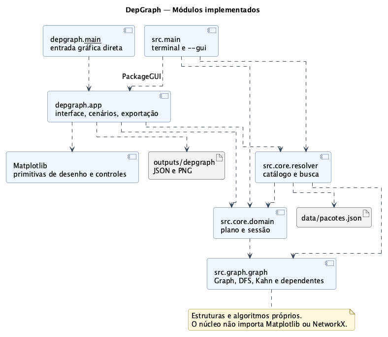

## Problema e objetivo

Instalar ou atualizar um pacote exige satisfazer dependências diretas e transitivas. Versões incompatíveis podem impedir uma seleção e dependências circulares podem impedir uma ordem segura. O DepGraph recebe um catálogo, um estado inicial e um pedido. A saída é um plano executável em uma simulação ou um diagnóstico que identifica o bloqueio.

## Modelagem e justificativa

O grafo é dirigido. Cada vértice identifica um pacote com a versão selecionada, e cada aresta de A para B indica que A é pré-requisito de B. Essa direção permite executar a ordenação topológica diretamente como precedência de instalação. Dependências compartilhadas convergem no mesmo vértice. Restrições de versão e conflitos são tratados na seleção dos pacotes. Um grafo sem ciclos só constitui um plano elegível após essas regras serem satisfeitas.

As listas de sucessores e predecessores permitem calcular graus de entrada e percorrer dependentes. Kahn calcula a ordem e as camadas. DFS reconstrói um ciclo quando a ordenação é impossível. BFS identifica dependentes alcançáveis para a consulta de impacto da remoção. O resolvedor usa backtracking para testar versões, e a sessão valida o estado completo antes de confirmar a transação.

## Levantamento de dados

O projeto considerou o diretório oficial de pacotes Debian e sua especificação de relações. A equipe escolheu um catálogo sintético para controlar os cenários e simplificar versões, alternativas e arquiteturas. O catálogo inclui 27 nomes, 32 versões e dois pacotes inicialmente instalados. Os pedidos e diagnósticos esperados estão documentados em `data/README.md`. A justificativa e as referências estão em `docs/dados.md`.

## Plano de desenvolvimento e critérios

| Ordem | Trabalho | Evidência prevista |
|-------|-----------------------------------------------|------------------------------------------------|
| 1 | Definir o problema, os cenários e a UML | Casos de uso, classes, componentes, sequências, estados e atividade |
| 2 | Implementar grafo e algoritmos próprios | Testes de precedência, ciclos, duplicação e alcance |
| 3 | Implementar catálogo, resolução e sessão | Escolhas compatíveis, bloqueios explicáveis e confirmação após validação |
| 4 | Integrar CLI, interface e exportação | Grafo, diagnósticos, avanço da transação e arquivos JSON/PNG |
| 5 | Verificar correção e avaliar desempenho | Testes, oráculo, dados brutos e comparação de escalas |
| 6 | Consolidar entrega | Artigo SBC, slides, roteiro e pacote reproduzível |

\newpage

## Arquitetura e vistas UML

A CLI e a janela usam o mesmo catálogo, resolvedor e sessão. A estrutura própria de grafo fornece a ordem e as camadas para a interface. O Matplotlib desenha as dependências e recebe as interações do usuário.

{width=95%}

A galeria com as oito vistas e suas fontes está em `docs/modelagem/modelagens-principais.md`. A descrição detalhada dos contratos está em `docs/modelagem/documentacao-completa.md`.
